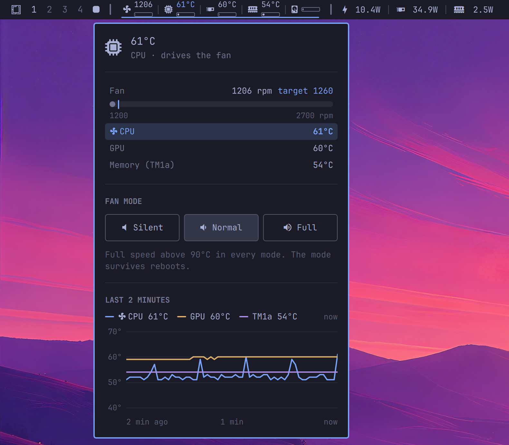

# iMac Stats

[](LICENSE)
[](https://omarchy.org)

A minimal `bar-widget` plugin for the [Omarchy](https://omarchy.org/) shell (Quickshell) on an Intel iMac, plus a small fan daemon. Shows fan RPM, CPU/GPU temp and usage, memory temp and RAM usage, and disk usage as a static row of icon+value pairs. Clicking opens a fan mode picker, with the reading that drives the fan highlighted and a chart of the last two minutes of CPU, GPU and memory temps.



Built for an iMac15,1 (Retina 5K, late 2014: i5-4690, Radeon R9 M290X/M295X) and adapted from [omarchy-minimal-liquid-stats](https://github.com/marionuevo/omarchy-minimal-liquid-stats).

## Why a daemon

`mbpfan` only reads `coretemp`. A GPU-only load (a game, `glmark2`) heats the Radeon while the fan sits at its 1200 rpm floor. CPU and GPU are not enough either: streaming a full-screen 4K picture at 60 fps kept both near 60°C and the fan near its floor while the memory (SMC probe `TM1a`) kept climbing, until the SMC powered the iMac off. Every second `imac-fand` reads `coretemp`, `amdgpu` and all of the SMC's own probes, puts each on the curve for its kind of sensor, and sets the SMC fan target from whichever asks for the most.

It runs as a root systemd service, separate from the shell: if the bar or the whole desktop dies, the fan keeps being regulated. When the daemon stops, it hands the fan back to the SMC's automatic control (`fan1_manual = 0`, or `pwm1_enable = 2` on newer kernels); the unit's `ExecStopPost` does the same if the process is killed outright.

## Memory: TM1a and a RAM power cap

`TM1a` is the system RAM (the SO-DIMMs or their regulator), found by loading one thing at a time on an iMac15,1:

| Load | TM1a | CPU | GPU |
|---|---|---|---|
| RAM, `stress-ng --stream 4`, 90 s | 51.5 → **90.5°C** | +5 | — |
| CPU, `stress-ng --cpu 4`, 4 min | +2 | 46 → 54.5°C | — |
| VRAM, `memtest_vulkan`, 4.5 min | none | — | +28 (TG0E/TG0F) |

It answers to memory bandwidth, not to CPU work, and it moves fast (−30°C two minutes after the load stops). DDR3 is in spec up to 85°C. Real loads that get there redraw the 5K panel nonstop: Omarchy's screensaver in Foot, which draws on the CPU, took the RAM from 2.3 W to 6.2 W and TM1a from 58 to 77°C in a minute with the fan at full speed. The same screensaver in Alacritty, which draws on the GPU, left the RAM at 2.5 W and TM1a at 58°C: on this iMac, use a GPU terminal.

The SMC does not protect the RAM by itself. It reads its probes, runs the fan on its own curve when nobody else does, and as a last resort powers the iMac off. Under macOS the operating system does the fine thermal management on Intel Macs; under Linux `applesmc` only exposes the probes and the fan. The memory controller's own thermal throttling needs a sensor on the module, and these SO-DIMMs have none: `TM1a` is a board thermistor only the SMC can see.

So `imac-fand` caps the RAM itself through the RAPL `dram` domain: from 78°C it lowers the limit from 7 W towards 3 W (reached at 84°C), and it releases the limit below 74°C. The i5-4690 honours it by slowing the memory, but never goes below ~6 W under `stress-ng`, whatever the limit, and a slower CPU does not help (7.8 W of RAM at 800 MHz). With the cap, `stress-ng --stream` reached 82°C at 90 s instead of 90.5°C. The daemon publishes the RAM's power (`ramWatts`) and the active cap (`ramCap`), since only root can read RAPL energy. The panel shows a "RAM power · capped" row while the cap is on, and the bar marks the memory reading with `!`.

## GPU power from the SMC

`amdgpu` reports no power for this Southern Islands Radeon: its hwmon has a `PPT` label but no `power1_input` or `power1_average`. The SMC measures the power rails itself, though, under keys only root can read through `applesmc`'s `key_at_index` files. `PGTR` is the GPU's total rail, so `imac-fand` publishes it as `gpuWatts`, and `PDTR`, the power supply's DC output (everything the iMac draws: ~81 W at idle, ~37 W of it panel backlight, board, disk and fan), as `dcWatts`. `PCTR` is the CPU's. `PZ5G` looks like a total too, but jumps between 99 and 126 W at a steady load: with `PZ5E` at 310 W, the power supply's rating, it reads as a power budget, not a measurement. [omarchy-power-widget](https://github.com/marionuevo/omarchy-power-widget) shows both next to the CPU and RAM power, the total as a dashed line in its chart.

Showing the 5K desktop at idle the GPU draws ~35 W; with the panel off (DPMS) ~8 W, a few seconds after it goes dark. Most of the idle draw is driving the panel: two DisplayPort links and the GDDR5 held at its top clock (1365 MHz), since a 5K frame at 60 Hz leaves too short a blanking period to switch memory clocks unnoticed.

## Sensors

| Icon | Value | Source |
|------|-------|--------|
| 󰈐 fan | Fan RPM (`!` when the daemon is down) | `applesmc` `fan1_input` |
|  CPU | CPU temp / usage % | `coretemp` "Package id 0", `/proc/stat` |
| 󰢮 GPU | GPU temp / usage % | `amdgpu` "edge" (SMC `TG0D` as daemon fallback), `radeontop` |
|  memory | Memory temp / RAM usage % | SMC `TM1a`, `/proc/meminfo` |
| 󰋊 disk | `/` usage % | `shutil.disk_usage` |

`gpu_busy_percent` is not implemented for this Southern Islands Radeon, so GPU usage comes from a one-second `radeontop` sample that overlaps the CPU sample.

The fan is found through `/sys/devices/platform/applesmc.*`. Up to kernel 7.2.5 `applesmc` keeps its own `fan1_manual` / `fan1_output` there and registers no hwmon `name` file. From `linux-omarchy` 7.2.8 the driver uses `hwmon_device_register_with_info`: the files move to `hwmon/hwmon*/` and the controls become the standard `pwm1_enable` (1 manual, 2 auto) and `fan1_target`, with no aliases. The daemon and the widget handle both.

## Fan modes

Curves in **normal** mode, as the temperature where the fan leaves its 1200 rpm floor and where it reaches max (~2700 rpm):

| Sensors | SMC keys | Floor until | Max at |
|---------|----------|-------------|--------|
| CPU | `coretemp` package, `TC*` | 60°C | 85°C |
| GPU | `amdgpu` edge, `TG*` | 60°C | 85°C |
| Memory | `TM*`, `Tm*` | 58°C | 72°C |
| Board (PCH, power supply, SSD, LCD, air) | the rest | 60°C | 80°C |

**Silent** moves every curve up by 8°C at the floor and 5°C at the max; **full** is always max. In every mode, CPU or GPU at 90°C or more means full speed, and so does losing every sensor. Probes that read below 20°C or from 127°C up (absent or broken: the SMC reports them as −127, 0, 1…) are ignored. The Radeon idles around 55°C, so its knee sits above that; the memory idles near 48°C and reached 68°C with the fan at full speed under the 4K stream. The panel shows which sensor is driving the fan. Ramp is up to +400 rpm per second, down at −40 rpm per second, so bursty loads don't make the fan hunt.

The mode lives in `/var/lib/imac-fan/mode`, the only file the desktop user may write; the daemon treats anything that isn't a known mode as `normal`. It survives reboots. The daemon publishes what it is doing in `/run/imac-fan/status.json`, which the widget reads.

## Power profiles that do something

The i5-4690 is a Haswell without HWP, so the kernel runs `intel_pstate` in passive mode and `power-profiles-daemon` has nothing to write but the energy-performance bias, which Haswell all but ignores. Measured with 4 busy threads in **power-saver**: 3.69 GHz and 64 W, the same as performance. Any profile picker (Omarchy's menu, [omarchy-power-widget](https://github.com/marionuevo/omarchy-power-widget)) switches the profile, and nothing changes.

`power/imac-power-profile` applies real limits whenever the profile changes (a systemd path unit watches `/var/lib/power-profiles-daemon/`) and once at boot, since the firmware resets RAPL every boot:

| Profile | Turbo | Max frequency | Governor | PL1 (RAPL long term) | Radeon DPM |
|---------|-------|---------------|----------|----------------------|------------|
| **power-saver** | off | 2.4 GHz | `schedutil` | 35 W | `auto` |
| **balanced** | on | 3.9 GHz | `schedutil` | firmware default (100 W) | `auto` |
| **performance** | on | 3.9 GHz | `performance` | firmware default | `auto` |

The Radeon is left on `auto` in every profile. Pinned to `low` it could not keep up with a full-screen 4K stream at 60 fps and hung the GPU; on `auto` it already idles at its lowest level.

The firmware's PL1 is saved to `/var/lib/imac-power/pl1-default` the first time the script runs, so balanced and performance restore exactly what Apple set. Each switch is logged:

```sh
sudo ~/.config/omarchy/plugins/marionuevo.imac-stats/power/install.sh
journalctl -t imac-power-profile
```

## Installation

```sh
omarchy plugin add https://github.com/marionuevo/omarchy-imac-stats.git --enable
omarchy bar put marionuevo.imac-stats --section left
sudo ~/.config/omarchy/plugins/marionuevo.imac-stats/daemon/install.sh
```

`install.sh` disables `mbpfan`, installs `imac-fand` to `/usr/local/bin`, the unit to `/etc/systemd/system`, gives the mode file to the user who ran `sudo`, and starts the service. The unit also `Conflicts=mbpfan.service`, so the two can never fight over the fan.

```sh
systemctl status imac-fand
cat /run/imac-fan/status.json
```

## Requirements

- Omarchy running on Hyprland
- Python 3
- `applesmc` and `coretemp` (loaded by default on Intel Macs), `amdgpu`
- `radeontop` for GPU usage (optional; shows `--%` without it)
